# ESP32 kamera za Home Assistant: ESP32-WROVER-DEV + OV5640 i ESP32-CAM + OV2640

ESP-IDF firmware koji od ESP32 ploče sa kamerom pravi samostalnu Wi-Fi IP kameru bez cloud-a. Isti kod radi na dve ploče, svaka sa svojim PlatformIO okruženjem: **ESP32-WROVER-DEV v1.6 + OV5640 (5 MP)** i **AI-Thinker ESP32-CAM + OV2640 (2 MP)** (vidi [Podržane ploče](#podržane-ploče)). Ima web interfejs, REST API, MJPEG stream, WebSocket telemetriju i MQTT/Home Assistant integraciju. Detektuje pokret, sabotažu kamere (prekrivena ili pomerena) i osobe na samom ESP32, broji prelaske linije, a preko eksternog servera prepoznaje objekte i opisuje događaje vision LLM-om.

Detaljan opis modula, tokova podataka i memorije je u **[docs/ARHITEKTURA.md](docs/ARHITEKTURA.md)**.

## Izgled web interfejsa

> Mockup slike: pravi web UI iz firmware-a sa izmišljenim podacima i sintetičkom scenom umesto snimka kamere.

| | |
|---|---|
| 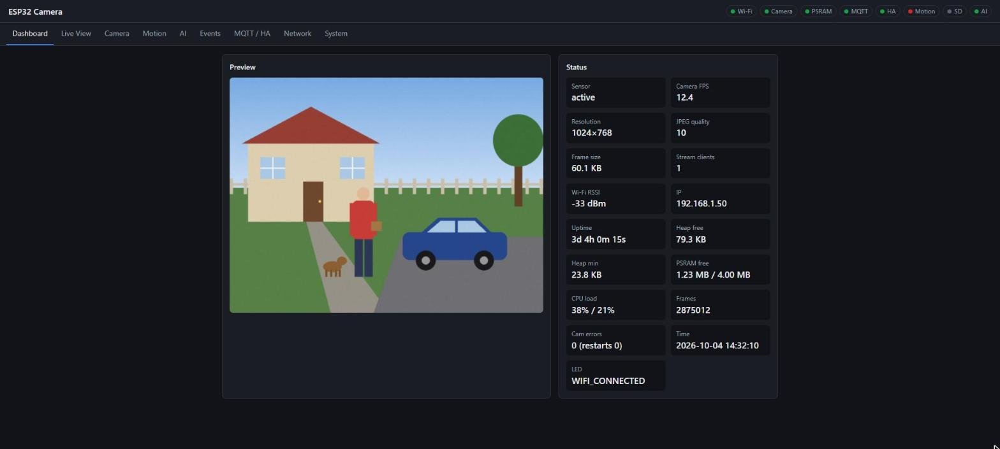 **Dashboard**: pregled sa indikatorima (tamper, pokret, osoba, AI), FPS, Wi-Fi, memorija, CPU, stanje modula | 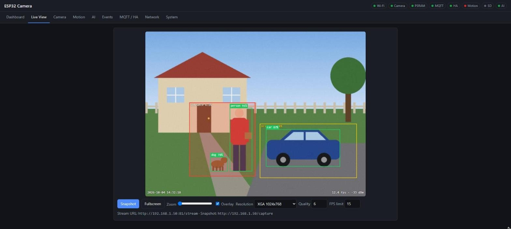 **Live View**: MJPEG stream, zone pokreta, AI okviri, overlay |
| 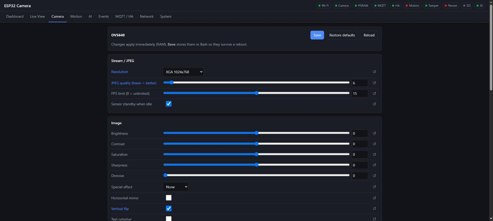 **Camera**: sva podešavanja OV5640 senzora | 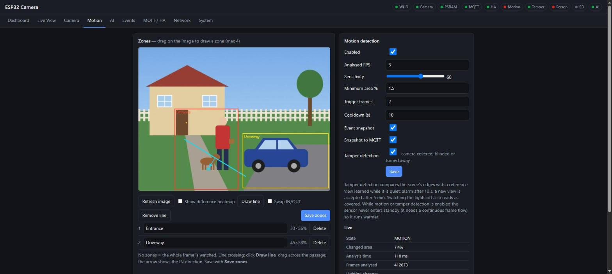 **Motion**: zone, linija za brojanje, tamper, heatmap razlika, stanje |
| 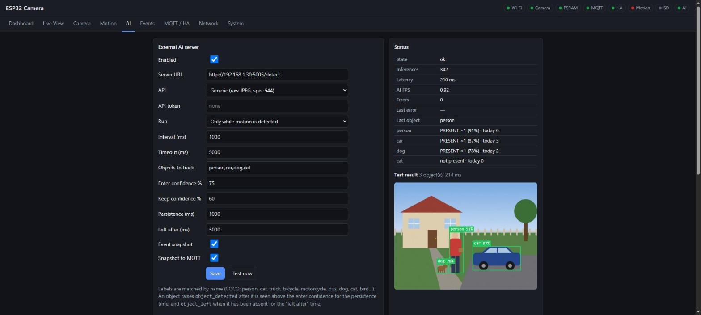 **AI**: lokalna detekcija osobe i šta model vidi | 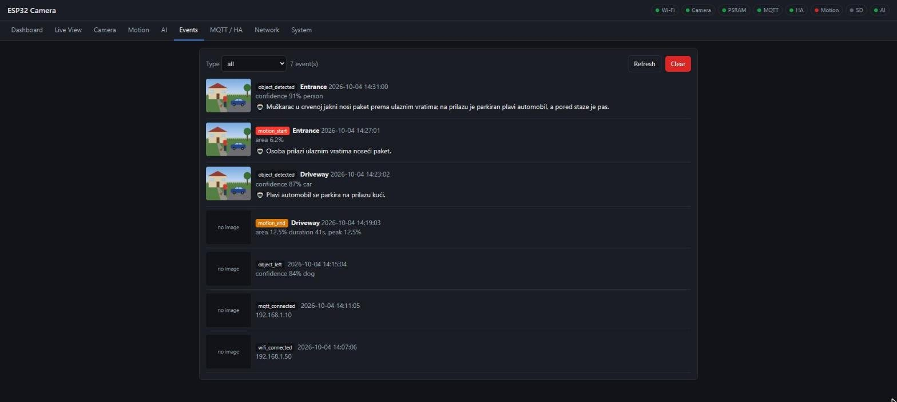 **Events**: događaji sa snapshot-ima i AI opisima |
| 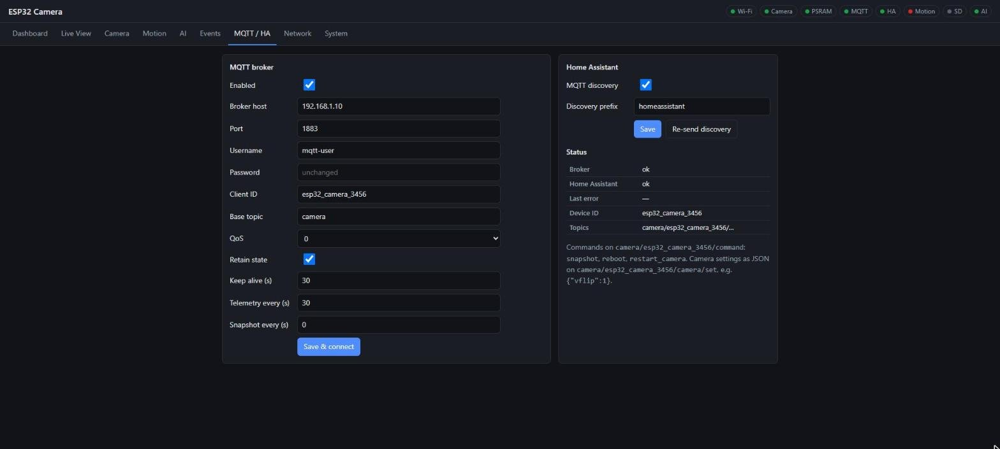 **MQTT / HA**: broker i Home Assistant discovery | 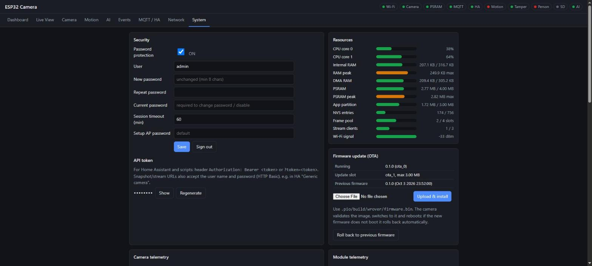 **System**: sigurnost, API token, OTA, iskorišćenost resursa, telemetrija |
| 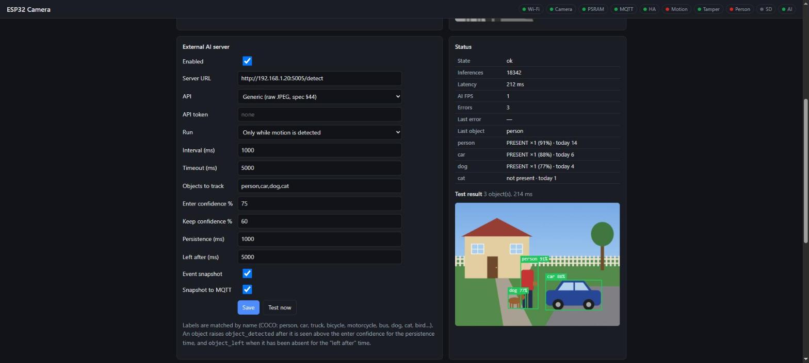 **AI**: eksterni AI server, praćenje objekata, test detekcije | 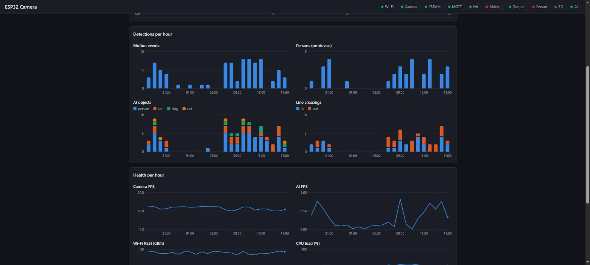 **Stats**: detekcije po satu i zdravlje sistema za 24 h |
| 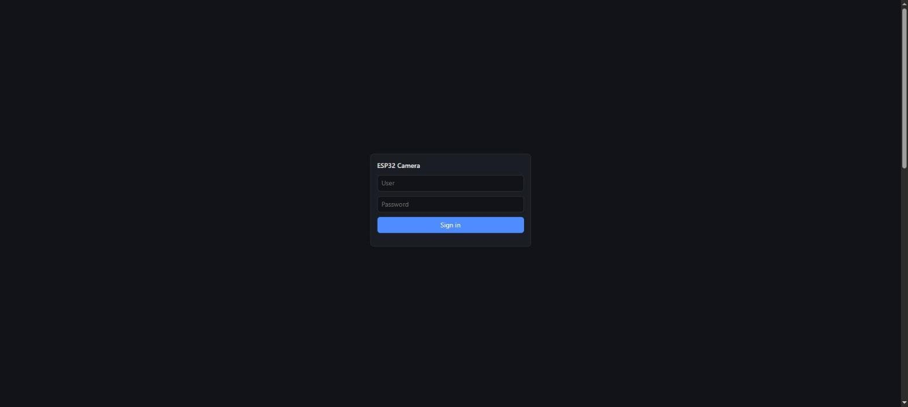 **Prijava** | |

## Podržane ploče

| | **ESP32-WROVER-DEV v1.6** | **AI-Thinker ESP32-CAM** |
|---|---|---|
| PlatformIO okruženje | `wrover` (podrazumevano) | `esp32cam` |
| Čip | ESP32-D0WDQ6 rev 1 | ESP32-D0WDQ6 rev 1 |
| Flash / PSRAM | 8 MB / 4 MB | 4 MB / 4 MB (čip od 8 MB, mapirano 4 MB) |
| Kamera | OV5640, **sa autofokusom**, rezolucija do 2048×1536 (3 MP) | OV2640, rezolucija do 1600×1200 (UXGA), fiksni fokus |
| Particije | `partitions.csv`: 2 × 3 MB OTA, coredump, storage | `partitions_4mb.csv`: 2 × 1,875 MB OTA, coredump |
| Statusni LED | GPIO 2 | GPIO 33 (crveni, aktivan na niskom nivou) |
| microSD | nema slota | ugrađen slot (SDMMC 1-bit): slike događaja, timelapse, preuzimanje |
| USB / flešovanje | CH340 na ploči, auto-reset radi | ESP32-CAM-MB adapter (CH340); posle prvog flešovanja preporučen OTA |
| Napajanje | USB | **eksterno 5 V** (vidi napomene ispod) |
| Standby senzora | da (OV5640 power-down) | ne (OV2640 ga ne podnosi, vidi ispod) |
| Opcione funkcije | sve uključene | lokalna osoba, eksterni AI, LLM opis, statistika i Events tab isključeni ([vidi ispod](#opcione-funkcije-izbor-pri-build-u)) |

Ploča se bira u Kconfig-u (`menuconfig` → *ESP32 Camera board* → *Board*). Izbor ploče postavlja podrazumevane pinove, LED i opcione funkcije. Okruženje `esp32cam` to radi samo, preko `sdkconfig.esp32cam.defaults`.

### Opcione funkcije (izbor pri build-u)

Pojedine funkcije se biraju pri build-u (`menuconfig` → *ESP32 Camera board* → *Optional features*). Isključena funkcija se uopšte ne kompajlira: ne zauzima flash, ne troši RAM i nema task. Web UI sakriva njene tabove i kartice, a Home Assistant uklanja njene entitete.

| Opcija (Kconfig) | Funkcija | WROVER | ESP32-CAM |
|---|---|---|---|
| `FEATURE_PERSON` | Lokalna detekcija osobe (TFLite Micro, ~360 KB flash) | uključeno | **isključeno** |
| `FEATURE_AI` | Eksterni AI server (detekcija objekata) | uključeno | **isključeno** |
| `FEATURE_LLM` | AI opis događaja (Ollama / Open WebUI) | uključeno | **isključeno** |
| `FEATURE_STATS` | Statistika po satu (Stats tab) | uključeno | **isključeno** |
| `FEATURE_EVENT_LOG` | Dnevnik događaja sa slikama (Events tab) | uključeno | **isključeno** |

Na ESP32-CAM-u su isključene da bi ploča od 4 MB imala dovoljno flash-a i internog RAM-a za **stabilan rad 24/7**. Firmware tada zauzima ~72 % OTA slota (umesto ~97 %), a statički interni RAM pada sa 74 KB na 58 KB. Bez `FEATURE_EVENT_LOG` događaji i dalje idu na MQTT / Home Assistant i na SD karticu; čuva se samo mali bafer za predaju slike SD kartici.

ESP32-CAM build nema ni **TLS klijent** (`CONFIG_ESP_HTTP_CLIENT_ENABLE_HTTPS=n`, `CONFIG_MQTT_TRANSPORT_SSL=n` u `sdkconfig.esp32cam.defaults`), pa AI server, Ollama i MQTT broker moraju biti dostupni preko običnog HTTP-a / MQTT-a u lokalnoj mreži.

**Uključivanje na ESP32-CAM-u:** dodaj npr. `CONFIG_FEATURE_PERSON=y` u `sdkconfig.esp32cam.defaults` (ili izaberi u `pio run -e esp32cam -t menuconfig`), obriši `sdkconfig.esp32cam`, pa ponovo builduj i fleši. Prati veličinu firmware-a: OTA slot ima 1,875 MB.

Web UI se u firmware ugrađuje **gzip-kompresovan** (101 KB → ~30 KB; pravi ga `tools/gzip_web.py` pri svakom build-u) i šalje sa `Content-Encoding: gzip`.

### Ploča 1: ESP32-WROVER-DEV v1.6 + OV5640

- OV5640 na SCCB adresi 0x3C, sa autofokusom: Camera tab → *Autofocus*. **Continuous** stalno drži fokus (prvo fokusiranje ~1,5–3 s, a kad se scena promeni, traži ponovo); **Single** drži sočivo, a dugme *Focus now* fokusira jednom (~3 s). Komande AF mikrokontroleru firmware šalje sam, po standardnom OV5640 redosledu: drajver esp32-camera odustaje posle 2 s, a senzoru treba ~4 s. Radi samo na modulima sa motorom za fokus (VCM).
- Pinout je WROVER-KIT/Freenove: XCLK 21, SDA 26, SCL 27, D7..D0 = 35, 34, 39, 36, 19, 18, 5, 4, VSYNC 25, HREF 23, PCLK 22, PWDN i RESET nisu povezani.
- Statusni LED na GPIO 2.
- Ploča nema SD slot. Pinovi koje WROVER-KIT koristi za SD zauzeti su kamerom (GPIO 4), pa bi microSD tražio SPI modul na slobodnim pinovima.

```sh
pio run -e wrover                 # build
pio run -e wrover -t upload       # flash (port u platformio.ini)
pio device monitor -e wrover      # serijska konzola, 115200
pio run -e wrover -t menuconfig   # sdkconfig / pinovi
```

### Ploča 2: AI-Thinker ESP32-CAM + OV2640

- OV2640 na SCCB adresi 0x30. Pinout: PWDN 32, XCLK 0, SDA 26, SCL 27, D7..D0 = 35, 34, 39, 36, 21, 19, 18, 5, VSYNC 25, HREF 23, PCLK 22.
- Statusni LED je crveni LED na GPIO 33. Beli blic LED (GPIO 4) firmware drži ugašenim.
- microSD radi u 1-bitnom SDMMC modu (CLK 14, CMD 15, D0 2), pa GPIO 4 (blic) i GPIO 12 (strapping pin za napon flash-a) ostaju van upotrebe.
- **Napajanje:** napajana preko USB-a i MB adaptera, kamera nije odgovarala na SCCB magistrali, a ploča se pri uključivanju zaustavljala u download modu. Na stabilnom **eksternom napajanju od 5 V** (pin 5V i GND, bar 500 mA) sve radi. Ne napajaj je preko pina 3V3.
- **Prvo flešovanje preko MB adaptera:** auto-reset ne radi pouzdano. Drži **IO0**, kratko pritisni **RST**, pusti IO0, pa pokreni upload. Posle upisa pritisni samo RST (ili isključi i uključi napajanje) da se pokrene firmware.
- **Kasnije: OTA.** Kad je ploča na mreži, firmware se šalje sa System → Firmware update (`.pio/build/esp32cam/firmware.bin`), bez tastera i USB-a.
- Firmware zauzima oko 72 % OTA slota od 1,875 MB (sa podrazumevano isključenim opcionim funkcijama).

```sh
pio run -e esp32cam                 # build
pio run -e esp32cam -t upload       # flash (IO0 + RST pre pokretanja)
pio device monitor -e esp32cam      # serijska konzola, 115200
```

### Modul kamere

Na tabu **Camera**, kartica *Camera module*, bira se koji je modul utaknut: **Auto** (OV5640 na WROVER-u, OV2640 na ESP32-CAM-u), **OV5640** ili **OV2640**. Oba modula rade na obe ploče. Veličinu JPEG bafera određuje senzor koji drajver stvarno pronađe: ako se razlikuje od izabranog, drajver se jednom ponovo pokreće sa pravim baferima, a Camera tab prikazuje upozorenje.

**Najveća rezolucija:** OV5640 do **2048×1536 (3 MP)**, OV2640 do **1600×1200**. ESP32 ima samo 4 MB PSRAM-a: na 2560×1440 i 2560×1920 frejmovi povremeno ne stižu (ponestane PSRAM-a i internog DMA RAM-a, ploča može da se zaglavi), a puni 2592×1944 ne daje nijedan frejm ni na jednom XCLK taktu. Veće rezolucije se zato ne nude, a ranije sačuvana veća vrednost se spušta na najveću dozvoljenu.

JPEG baferi drajvera prate **trenutnu** rezoluciju: izbor veće rezolucije restartuje drajver jednom (~0,5 s), a od 1920×1080 naviše drajver koristi jedan bafer. Slike događaja u RAM-u imaju budžet od 1 MB (najnovije, najviše 12). Podešavanja koja senzor ne podržava (npr. autofokus na OV2640) automatski se skrivaju.

### Kamera se ne javlja

`GET /api/camera/scan` (ili serijska komanda `sccbscan`) uključi senzor, pusti XCLK takt i skenira SCCB magistralu. Ispravan senzor se javlja na adresi 0x30 (OV2640) ili 0x3C (OV5640). Prazna lista znači problem sa flat kablom, konektorom, modulom ili napajanjem.

ESP-IDF 5.3.2 se instalira automatski kroz PlatformIO (pioarduino platforma). Komponente `esp32-camera`, `mdns` i ostale preuzima IDF component manager.

## Prvo pokretanje

1. Ako Wi-Fi nije podešen, kamera podiže access point **`ESP32-CAM-XXXX`** sa lozinkom **`esp32camera`**.
2. Poveži se na taj AP i otvori **http://192.168.4.1** → *Network* → upiši SSID i lozinku → *Save & connect*.
3. Kada se kamera poveže, dostupna je na **http://esp32-camera-XXXX.local**. Tačna IP adresa piše u serijskom logu i na *Network* tabu. Setup AP se gasi 2 minuta nakon povezivanja.

Wi-Fi se može podesiti i preko serijske konzole: `wifi <ssid> <lozinka>`.

### Inicijalni podaci za prijavu

| | |
|---|---|
| Korisnik | **`admin`** |
| Lozinka | **`espadmin`** |

Zaštita je uključena od prvog pokretanja. Dok je inicijalna lozinka aktivna, web UI prikazuje upozorenje. **Promeni je odmah** na System → Security, jer je javno dokumentovana. Inicijalni podaci se vraćaju posle factory reset-a i serijskom komandom `auth reset`.

## Endpointi

| Metod | Putanja | Opis |
|---|---|---|
| GET | `/` | Web UI |
| GET | `:81/stream` | MJPEG stream (do 3 klijenta) |
| GET | `/capture`, `/api/snapshot` | JPEG snapshot |
| GET | `/api/status` | Status (FPS, heap, PSRAM, CPU, Wi-Fi, kamera) |
| GET/POST | `/api/camera` | Sva podešavanja kamere sa opsezima; POST primenjuje `{"id": vrednost}` u RAM |
| POST | `/api/camera/save` | Snima trenutna podešavanja u NVS |
| POST | `/api/camera/defaults` | Vraća podrazumevane vrednosti (u RAM) |
| POST | `/api/camera/af` | Pokreće autofokus |
| GET/POST | `/api/wifi` | Wi-Fi podešavanja |
| GET | `/api/wifi/scan` | Skeniranje mreža |
| GET | `/api/camera/scan` | Sken SCCB magistrale (dijagnostika kamere) |
| GET/POST | `/api/camera/reg` | Čitanje (`?reg=0x3029`) i upis (`{"reg":..,"value":..}`) registra senzora, za napredno podešavanje |
| GET | `/api/config/export[?secrets=1]` | Rezervna kopija podešavanja (JSON fajl) |
| POST | `/api/config/import` | Vraćanje podešavanja iz rezervne kopije |
| GET/POST | `/api/sd` | microSD: podešavanja i stanje kartice (samo ESP32-CAM) |
| GET | `/api/sd/files?dir=X` | Sadržaj foldera na kartici |
| GET | `/api/sd/files?path=X[&dl=1]` | Fajl sa kartice (`dl=1` = preuzimanje) |
| GET | `/api/sd/files?zip=X` | Ceo folder kao ZIP |
| POST | `/api/sd/action` | `{"action": "tl_start" \| "tl_stop" \| "eject" \| "mount" \| "format"}` |
| GET | `/api/coredump` | Core dump poslednjeg pada (ELF, za `esp-coredump info_corefile`) |
| GET/POST | `/api/system` | Informacije o sistemu i lista taskova; POST `{"device_name"}` |
| POST | `/api/time` | `{"epoch": <unix s>}`: postavlja vreme iz browsera ako NTP ne radi |
| POST | `/api/login`, `/api/logout` | Prijava (session cookie) / odjava |
| GET/POST | `/api/security` | Zaštita: lozinka, API token, timeout sesije, lozinka setup AP-a |
| GET/POST | `/api/ota` | Stanje OTA slotova / upload `firmware.bin` (samo uz uključenu zaštitu) |
| POST | `/api/ota/rollback` | Povratak na prethodni firmware |
| POST | `/api/reboot` | Restart |
| POST | `/api/factory-reset` | `{"wifi": true}` briše i Wi-Fi podešavanja |
| GET | `/api/telemetry` | Live registri senzora (ekspozicija, gain, AWB…) i telemetrija modula |
| GET/POST | `/api/mqtt` | MQTT/HA podešavanja |
| POST | `/api/mqtt/discovery` | Ponovo šalje HA discovery |
| GET/POST | `/api/motion` | Podešavanja i stanje detekcije pokreta, zone |
| GET | `/api/motion/debug` | Mreža razlika (heatmap) za podešavanje osetljivosti |
| GET/POST | `/api/ai` | Podešavanja i stanje eksternog AI-ja |
| POST | `/api/ai/test` | Jedna inferencija odmah (objekti + analizirani frame) |
| GET/POST | `/api/llm` | Podešavanja AI opisa (vision LLM) |
| POST | `/api/llm/test` | Opis trenutne slike (rezultat stiže u status) |
| GET/POST | `/api/person` | Lokalna detekcija osobe (na ESP32): podešavanja i stanje |
| POST | `/api/person/test` | Jedna provera odmah (skor + isečak 96×96 koji model vidi) |
| GET | `/api/events` | Dnevnik događaja (`?limit=N`) |
| GET | `/api/events/snapshot?id=N` | Snapshot događaja |
| POST | `/api/events/clear` | Briše događaje |
| GET | `/api/stats` | Statistika po satu za poslednja 24 h |
| POST | `/api/stats/reset` | Briše statistiku |
| WS | `/ws` | Status svake sekunde i događaji u realnom vremenu |

## Sigurnost

Zaštita je uključena od prvog pokretanja, sa inicijalnim podacima `admin` / `espadmin` (vidi gore). Korisnik i lozinka se menjaju na **System → Security**. Zaštićeno je sve: `/api/*`, `/capture`, stream na portu 81 i WebSocket.
- **Web UI:** prijava sa sesijom. Cookie je HttpOnly i SameSite=Strict, a sesija ističe posle zadatog vremena neaktivnosti.
- **Home Assistant i skripte:** API token (`Authorization: Bearer <token>` ili `?token=<token>`), ili HTTP Basic sa korisnikom i lozinkom, npr. u HA „Generic camera“.
- **Lozinka** se čuva kao PBKDF2-SHA256 sa salt-om. Posle 5 pogrešnih pokušaja prijava se privremeno zaključava.
- **OTA** (System → Firmware update) radi samo kad je zaštita uključena. Ako novi firmware ne može da se pokrene, kamera se automatski vraća na prethodni.
- **Zaboravljena lozinka** (potreban je fizički pristup, USB):
  - serijska komanda `auth reset` vraća `admin` / `espadmin` sa uključenom zaštitom;
  - `auth off` privremeno isključuje zaštitu, a lozinka ostaje sačuvana;
  - `auth token` ispisuje API token.
- Lozinka setup AP-a se menja u istoj kartici.

## MQTT / Home Assistant

Podešava se na tabu **MQTT / HA**. Topici imaju oblik `camera/<device>/…`, gde je `<device>` hostname sa `_` umesto `-`, npr. `esp32_camera_0064`:

| Topic | Sadržaj |
|---|---|
| `availability` | `online` / `offline` (retained, Last Will) |
| `telemetry` | JSON: rssi, fps, heap, psram, uptime, cpu, camera_ok, URL-ovi (retained, period podesiv) |
| `snapshot` | JPEG slika za HA MQTT camera entitet (retained) |
| `event` | JSON događaji (pokret, tamper, osoba, AI objekti, linija, OTA…) |
| `command` | `snapshot`, `reboot`, `restart_camera` |
| `motion`, `motion/zoneN` | `ON` / `OFF` (retained) |
| `motion/set` | `ON` / `OFF`: uključuje ili isključuje detekciju pokreta |
| `person`, `car`, … | JSON po praćenoj klasi: `{"detected":true,"confidence":0.92,"x","y","width","height","zone","timestamp"}` (retained) |
| `person_local` | JSON lokalne detekcije osobe `{"detected","confidence","zone","timestamp"}` (retained) |
| `person_local/set` | `ON` / `OFF`: uključuje ili isključuje lokalnu detekciju osobe |
| `night` | `ON` / `OFF`: noćni režim (retained) |
| `line` | JSON brojača prelaska linije `{"in","out","last"}` (retained) |
| `tamper` | JSON `{"state":"ON"/"OFF","reason":"covered"/"dark"/"moved"}` (retained) |
| `description` | JSON poslednjeg događaja sa AI opisom (retained) |
| `ai/set` | `ON` / `OFF`: uključuje ili isključuje AI; komande `ai_on` / `ai_off` na `command` |
| `camera/set` | JSON podešavanja kamere, npr. `{"vflip":1,"quality":10}` |

Kad je discovery uključen, HA automatski dobija uređaj sa kamerom (snapshot), dijagnostičkim senzorima i dugmadima. Ponovo ga šalje kad se HA restartuje (`homeassistant/status`).

## Detekcija pokreta

Tab **Motion**: zone se crtaju prevlačenjem preko slike. Heatmap prikazuje šta senzor vidi kao promenu.
- *Sensitivity*: koliko se pojedinačna ćelija mora promeniti.
- *Minimum area*: koji deo zone se mora promeniti.
- *Trigger frames*: koliko frame-ova zaredom.
- *Cooldown*: koliko mirnih sekundi pre nego što pokret završi.

Nagla promena većine slike, npr. kad se upali svetlo, ne pokreće alarm. Dok je detekcija uključena, senzor ne ide u standby.

Dekodiranje JPEG-a za analizu traje 200–350 ms (XGA), pa analiza ne zauzima više od oko polovine jezgra: ako traženi *Analysed FPS* ne može da se postigne, stvarni FPS se smanji (vidi se na Motion tabu kao *Analysis time*).

## Lokalna detekcija osobe (na samom ESP32)

> Opcija `FEATURE_PERSON`: uključena na WROVER-u, isključena na ESP32-CAM-u.

Radi bez servera i bez interneta: TensorFlow Lite Micro model „person detection“ (Apache-2.0, 96×96, ~300 KB) izvršava se na ESP32.
- **Rezultat:** samo „osoba / nije osoba“ sa verovatnoćom, bez okvira i bez drugih klasa.
- **Brzina:** oko 0,7 s po proveri.
- **Kada radi:** dok traje pokret (podrazumevano) ili stalno. Model gleda kvadrat isečen oko mesta pokreta, pa prepoznaje i udaljenije osobe.
- **Događaji:** posle *confirm* uzastopnih pogodaka iznad praga stiže `person_detected_local` (sa snapshot-om i zonom), a posle *left after* sekundi bez pogotka `person_left_local`.
- **HA:** binary senzor „Person (local)“ i prekidač „Person detection (local)“.

## Prelazak linije

Na Motion tabu: **Draw line**, pa prevuci liniju preko prolaza. Strelica pokazuje smer **IN** („Swap IN/OUT“ ga okreće). Snima se sa **Save zones**.
- Kamera prati težište pokreta i broji prelaske, uz histerezu oko linije.
- Događaji `line_in` / `line_out`; HA senzori „Line in today“ / „Line out today“.
- Linija i brojači se vide i na Live View-u.
- Radi dok je detekcija pokreta uključena. Najpouzdanije je kad kroz prolaz ide jedna osoba odjednom.

## Sabotaža kamere (tamper)

Uključuje se na Motion tabu (*Tamper detection*, podrazumevano isključeno). Radi i kad je detekcija pokreta isključena.
- Kamera pamti mapu ivica scene kao referencu i osvežava je dok je scena mirna (bez pokreta i bez sumnje najmanje 30 s).
- **Prekrivena** (`covered`): energija ivica padne ispod 25 % reference, ili nestane većina ivica uz pad energije ispod 50 %. Ako je slika i tamna, razlog je `dark`.
- **Pomerena** (`moved`): nestane više od 60 % referentnih ivica, a energija ostane.
- Alarm (`tamper`, sa snapshot-om) stiže kad stanje traje 10 s. Prestaje (`tamper_cleared`) 3 s posle povratka slike, a posle 5 min alarma kamera prihvata novi pogled kao referencu.
- **HA:** binary senzor „Tamper“ (device_class `tamper`), razlog je u atributima.
- Gašenje svetla u prostoriji se takođe vidi kao `dark`.

## AI detekcija objekata

> Opcija `FEATURE_AI`: uključena na WROVER-u, isključena na ESP32-CAM-u.

Klasični ESP32 je preslab za ozbiljnu lokalnu detekciju objekata (spec §42). Zato kamera šalje frame-ove na AI server u mreži, a server vraća detektovane objekte.
- **Režimi:** samo dok traje pokret (podrazumevano) ili stalno, na zadati interval.
- **Podržani serveri:**
  - priloženi `tools/ai_server` (YOLO): `pip install -r tools/ai_server/requirements.txt`, zatim `python tools/ai_server/server.py`, a u kameri URL `http://<host>:5005/detect`;
  - CodeProject.AI / DeepStack: URL `http://<host>:32168/v1/vision/detection`, API „DeepStack“.
- **Praćenje:** objekat se prijavljuje kao `object_detected` tek kad je viđen iznad *enter* praga tokom *persistence* vremena. Ostaje prisutan dok je iznad *keep* praga, a `object_left` stiže posle *left after* vremena bez detekcije (spec §60).

## AI opis događaja (Ollama / Open WebUI)

> Opcija `FEATURE_LLM`: uključena na WROVER-u, isključena na ESP32-CAM-u.

Kamera može da pošalje snapshot događaja (pokret ili AI objekat) vision modelu i da opis u jednoj rečenici priloži događaju. Opis se vidi u Events tabu, na MQTT-u `…/description` i u HA senzoru „Last description“, pa se može koristiti u obaveštenjima.
- **Ollama:** URL `http://<host>:11434/api/chat`, a model mora biti vision, npr. `qwen2.5vl:3b`, `gemma3:4b` ili `llava`.
- **Open WebUI / OpenAI API:** URL `http://<host>:3000/api/chat/completions` (ili Ollama `/v1/chat/completions`) i API ključ.

Šalje se samo jedna slika po događaju, uz cooldown, pa i spori CPU modeli rade.

## microSD i timelapse (ESP32-CAM)

Tab **Storage** (spec §18, §19). Na WROVER ploči tab samo kaže da ploča nema slot.
- **Kartica je montirana uvek kad je u slotu.** Fajlovi se mogu pregledati i preuzimati i kad je snimanje isključeno. Kartica treba da bude FAT32.
- **Recording** (podrazumevano isključeno) uključuje upis na karticu: slike događaja (pokret, osoba, AI objekat, tamper, linija) i zakazani timelapse.
- **Raspored fajlova:** `EVENTS/YYYYMMDD/HHMMSSTn.JPG` (T = vrsta događaja: M pokret, P osoba, O objekat, T tamper, L linija) i `TLAPSE/YYYYMMDD/HHMMSSn.JPG`.
- **Max usage % i Delete oldest:** kad kartica pređe zadatu zauzetost, brišu se najstariji dani.
- **Timelapse:** zakazani radi od *Start hour* do *Stop hour* na zadatom intervalu (isti sat za početak i kraj znači ceo dan; potrebno je podešeno vreme). **Start timelapse now / Stop timelapse** pokreću ga ručno, nezavisno od rasporeda. Kad se završi, događaj `timelapse_done` (i MQTT) javlja broj slika tog dana. Slike su u trenutnoj rezoluciji streama.
- **Fajlovi:** pregled po folderima, dugme *Download* pored svakog fajla i *Download ZIP* za folder. ZIP se pravi u hodu, bez kompresije, jer su JPEG-ovi već kompresovani.
- **Eject (safe removal)** pre vađenja kartice, **Mount** posle ubacivanja, **Format card** briše celu karticu (traži potvrdu).
- Događaji `sd_inserted` / `sd_removed` / `timelapse_done`; HA senzori „SD card“ i „SD free“.

## Rezervna kopija podešavanja

System tab → *Configuration backup* (spec §27):
- **Export** preuzima jedan JSON fajl sa podešavanjima kamere, detekcije pokreta, lokalne detekcije osobe, AI-ja, LLM opisa, MQTT-a, Wi-Fi-ja, microSD-a i imenom uređaja.
- Lozinke, tokeni i ključevi (Wi-Fi, MQTT, AI token, LLM ključ) ulaze **samo ako se štiklira** *include passwords*.
- **Import** vraća sve sekcije iz fajla i javlja šta je primenjeno. Bez lozinke u fajlu, sačuvane lozinke ostaju; Wi-Fi se menja samo ako je u fajlu lozinka ili ista mreža.
- Podešavanja prijave (korisnik, lozinka web UI-ja, API token) se **nikad** ne izvoze ni uvoze, pa vraćena kopija ne može da zaključa pristup. Izbor modula kamere se takođe ne prenosi, jer zavisi od ploče.

## Statistika

> Opcija `FEATURE_STATS`: uključena na WROVER-u, isključena na ESP32-CAM-u.

Tab **Stats** prikazuje poslednja 24 sata, po satu:
- **Zbirovi:** događaji pokreta, osobe (lokalno), AI objekti, prelasci linije IN/OUT, tamper alarmi.
- **Brojanje objekata** (spec §35): koliko ih je sada, danas i u poslednja 24 h, po klasi.
- **Detekcije po satu:** stubičasti grafikoni (AI objekti naslagani po klasi, prve četiri klase posebno, ostale kao „other“).
- **Zdravlje po satu:** FPS kamere, AI FPS, Wi-Fi RSSI, opterećenje CPU-a, najmanje slobodnog heap-a i PSRAM-a (uzorak na 10 s).
- Prelaz mišem preko grafikona prikazuje vrednosti sata; *Show table* daje iste podatke kao tabelu.

Statistika se čuva samo u RAM-u, jer brisanje flash-a dok kamera radi zaglavi ovu ploču. Posle restarta počinje od nule. Dok sat nije podešen, sati se broje od uključenja, a kad se vreme dobije (NTP ili browser), podaci se prebacuju na prave sate.

## Rotacija slike

Kad je kamera montirana bočno ili naopako, slika se okreće dugmadima **⟲ CCW** i **CW ⟳** (koraci od 90°) na Live View-u ili na Camera tabu (*Rotate image*). Da ostane posle restarta, klikni **Save** na Camera tabu.
- Senzor sam ne može da rotira sliku, a ponovno kodiranje JPEG-a bi preopteretilo ESP32. Firmware zato u svaki frame upisuje **EXIF oznaku orijentacije** (36 bajtova), a browser i Home Assistant sliku okreću sami. To važi za stream, snapshot, slike događaja i slike na SD kartici.
- Zone, linija za brojanje, heatmap i AI okviri se u UI-ju preslikavaju na rotiranu sliku. U firmware-u ostaju u koordinatama senzora, pa rotacija ne kvari već nacrtane zone.
- Lokalna detekcija osobe dobija uspravan isečak.
- Okretanje za 180° može i preko *Horizontal mirror* + *Vertical flip*, što radi sam senzor.
- Programi koji ignorišu EXIF (npr. neki AI serveri) vide neokrenutu sliku.

## Noćni režim (dan / noć)

Camera tab → *Night mode* (spec §31): **Off (day)**, **On (night)** ili **Auto**.
- **Auto** meri stvarnu osvetljenost scene: prosečnu svetlinu slike podeljenu sa ekspozicijom i pojačanjem, iz registara senzora (OV2640 i OV5640). Merenje ne zavisi od toga koliko je automatika pojačala sliku, pa nema treperenja između režima.
- **Prebacivanje sa histerezom:** noć posle 30 s ispod praga *Night when light below*, dan posle 60 s iznad praga *Day when light above*. Trenutni nivo svetla piše na kartici, pa se pragovi lako podese prema mestu montaže.
- **Noću:** crno-bela slika (*Black & white at night*; uklanja ljubičast/zelen šum modula bez IR filtera), najveći *Gain ceiling*, a na OV5640 i njegov noćni režim sa dužom ekspozicijom. Korisnička podešavanja ostaju netaknuta i vraćaju se danju.
- Nivo svetla se meri dok kamera snima (stream, detekcija pokreta ili tamper). Posle standby-ja odluka se donosi odmah, pri prvom merenju.
- Događaj `night_mode` (detalj `night`/`day`); MQTT `…/night` (`ON`/`OFF`); HA senzori „Night mode“ i „Scene light“.
- **Kalibracija:** pragovi su u istim jedinicama kao prikazani nivo svetla. Na OV2640 (ESP32-CAM) izmereno je ~535 u osvetljenoj sobi i ~130 sa ugašenim svetlom, pa su podrazumevani pragovi **noć ispod 200, dan iznad 400**. Na OV5640 je skala drugačija (podrazumevano 5 / 15). Ako se kamera prebacuje prerano ili prekasno, pogledaj nivo svetla na kartici u oba stanja i postavi pragove između njih.
- Za noćno snimanje u mraku treba IR osvetljenje (850 nm) i modul bez IR filtera.

## LED-ovi na ploči

Camera tab → *LEDs*:
- **Status LED** (WROVER: GPIO 2, ESP32-CAM: crveni na GPIO 33) može da se isključi. Tada miruje i dok neko gleda stream.
- **White flash LED** (samo ESP32-CAM, GPIO 4): **Off**, **On** ili **At night**, kad se pali zajedno sa noćnim režimom kao osvetljenje scene. Beli LED je jak i greje se, pa ga ne drži stalno upaljenog bez potrebe.

## Kamera, grejanje i standby

- OV5640 se primetno greje kad neprekidno snima. Hladnjak na modulu je preporučen.
- **OV5640:** odmah posle pokretanja, i kad niko ne gleda stream ni ne traži slike 10 s, senzor prelazi u **standby** (softverski power-down). Pri sledećem zahtevu se budi za ~0,5 s. Standby pri pokretanju smanjuje strujni udar dok se pali Wi-Fi. Ovo se isključuje opcijom *Sensor standby when idle* na Camera tabu.
- **OV2640:** standby se ne koristi. Softverski standby (COM2) na ovom modulu ugasi SCCB komunikaciju, a senzor se vraća tek kad se isključi napajanje. Restart ESP32 i OTA ne prekidaju napajanje kamere.
- **Detekcija pokreta i sabotaže drže senzor stalno budnim**, jer im trebaju frame-ovi. Isto važi za lokalnu detekciju osobe i prelazak linije, koji rade na osnovu pokreta.
- Podrazumevani *Gain ceiling* za OV5640 je 200 (~12,5x). Veća vrednost daje svetliju sliku pri slabom svetlu, ali i više šuma.

## Serijska konzola

USB (CH340), 115200 baud, npr. `pio device monitor`. Prompt je `cam>`.

| Komanda | Opis |
|---|---|
| `help` | Spisak komandi |
| `wifi <ssid> [lozinka] [hostname]` | Podešava Wi-Fi i povezuje se |
| `status` | Kompletan status u JSON-u |
| `cam` / `cam <podešavanje> <vrednost>` / `cam save` | Stanje kamere, promena podešavanja (u RAM), snimanje u flash |
| `ntp` | Vreme, dostupnost NTP servera, DNS i ručni NTP test |
| `auth reset` | Vraća inicijalne podatke `admin` / `espadmin`, zaštita uključena |
| `auth off` | Privremeno isključuje zaštitu (lozinka ostaje) |
| `auth token` | Ispisuje API token |
| `log <none\|error\|warn\|info\|debug\|verbose> [tag]` | Nivo logovanja |
| `sccbscan` | Dijagnostika kamere: sken SCCB magistrale |
| `reboot` | Restart |
| `factory_reset` / `factory_reset all` | Briše podešavanja (Wi-Fi ostaje) / sve, uključujući Wi-Fi |

## Statusni LED (GPIO 2 na WROVER-u, GPIO 33 na ESP32-CAM-u)

| Šablon | Stanje |
|---|---|
| Brzo treptanje | Pokretanje |
| 0,5 s uključen / 0,5 s isključen | Povezivanje na Wi-Fi |
| Dvostruki blic | Setup access point je aktivan |
| Kratak blic na 2 s | Povezan na Wi-Fi |
| Trostruki blic | Greška (npr. kamera se nije pokrenula) |
| Ravnomerno treptanje | OTA ažuriranje |
| **Stalno upaljen** | **Neko gleda stream** (indikator privatnosti, spec §29) |

## Home Assistant: primeri

Uređaj se pojavljuje automatski preko MQTT discovery-ja. Primeri ispod koriste podrazumevano ime uređaja „ESP32 Camera“, pa u HA proveri tačne `entity_id` vrednosti.

**Obaveštenje na telefon sa AI opisom i slikom:**

```yaml
automation:
  - alias: "Kamera: obaveštenje sa AI opisom"
    trigger:
      - platform: state
        entity_id: sensor.esp32_camera_last_description
    condition: "{{ trigger.to_state.state not in ['unknown', 'unavailable', ''] }}"
    action:
      - service: notify.mobile_app_telefon
        data:
          title: "ESP32 kamera"
          message: "{{ trigger.to_state.state }}"
          data:
            image: /api/camera_proxy/camera.esp32_camera_snapshot
```

**Osoba ispred kamere noću → svetlo:**

```yaml
automation:
  - alias: "Kamera: osoba noću"
    trigger:
      - platform: state
        entity_id: binary_sensor.esp32_camera_person_local
        to: "on"
    condition:
      - condition: sun
        after: sunset
    action:
      - service: light.turn_on
        target:
          entity_id: light.dvoriste
```

**Uživo slika u HA (Generic Camera):** *Settings → Devices & services → Add integration → Generic Camera*
- Still image URL: `http://<ip-kamere>/capture`
- Stream source: `http://<ip-kamere>:81/stream`
- Authentication: `basic`, sa korisnikom i lozinkom kamere. Umesto toga može i `?token=<API token>` na kraju URL-ova.

## Poznata ograničenja i rešeni problemi

- **Upis u flash dok kamera radi zaglavi ESP32 rev1 + PSRAM.** Interrupt watchdog resetuje čip, bez core dump-a. Firmware zato zaustavlja kameru tokom OTA upisa i potvrde novog firmware-a.
- **NTP:** ako ruter ili firewall blokira NTP za kameru, vreme se uzima iz browsera pri otvaranju web UI-ja (status pokazuje izvor: `ntp` ili `browser`).
- **Lokalna detekcija osobe** daje samo „osoba da/ne“. Za više klasa i okvire koristi se eksterni AI server.
- **Prelazak linije** prati jedno težište pokreta, pa je najpouzdaniji kad kroz prolaz ide jedna osoba odjednom.
- **Nisu urađeni:** HTTPS za web UI i MQTT preko TLS-a (kamera je predviđena za lokalnu mrežu).
- **microSD:** WROVER ploča nema slot (GPIO 4 je kamera); microSD radi samo na ESP32-CAM-u.
- **Neispravan modul kamere:** fiksne vertikalne pruge koje ne zavise od rezolucije, XCLK takta ni pojačanja (a JPEG je 2–3 puta veći nego inače) dolaze iz samog modula ili njegovog kabla, ne iz podešavanja. Zamena modula je rešila problem.
- **ESP32-CAM:** treba mu stabilno eksterno napajanje od 5 V, a za flešovanje preko USB-a IO0 + RST (vidi [Ploča 2](#ploča-2-ai-thinker-esp32-cam--ov2640)).
- **Napajanje WROVER-a:** na slabom USB napajanju ploča posle uključivanja ponekad ne krene dok se ne pritisne RST. Snimljeni logovi pokazuju dva slučaja: brownout petlju u trenutku pokretanja Wi-Fi-ja (strujni vrhovi 400–500 mA) i čip koji uopšte ne krene (spor porast napona / EN). Firmware smanjuje opterećenje (senzor u standby-ju dok se pali Wi-Fi), a pravo rešenje je hardversko: jače napajanje od 5 V i kratak kabl, 470–1000 µF na 5V i 1–10 µF na EN pinu.
- **Interni RAM:** Wi-Fi/TCP baferi i stekovi taskova dele oko 300 KB internog RAM-a. Kad slobodnog padne ispod 20 KB, lokalna detekcija osobe i slanje slika na MQTT se pauziraju; ako ostane ispod 12 KB 15 s, uređaj se sam restartuje (razlog „low memory (self-restart)“) umesto da ostane nedostupan. Na ESP32-CAM-u sa svim detekcijama uključenim preporučena rezolucija je do 1024×768.
- **OV5640 do 2048×1536:** na ESP32 sa 4 MB PSRAM-a veće rezolucije povremeno ne isporuče frejm, a puni 5 MP (2592×1944) ne radi ni na jednom XCLK taktu. Detalji u sekciji [Modul kamere](#modul-kamere).
- **Autofokus (OV5640):** drajver esp32-camera odustaje od AF komandi posle 2 s, a senzoru treba ~4 s; firmware zato šalje AF komande sam. Radi samo na modulima sa motorom za fokus.

## Struktura repozitorijuma

```text
main/                 firmware (ESP-IDF komponenta)
  web/index.html      web UI (u firmware se ugrađuje gzip-kompresovan)
  models/             TFLite model za detekciju osobe (Apache-2.0)
  Kconfig.projbuild   izbor ploče, pinovi kamere, LED, lozinka setup AP-a (menuconfig)
tools/ai_server/      referentni YOLO server za eksterni AI
tools/gzip_web.py     PlatformIO pre-build skripta: kompresuje web UI
tools/ui_mock/        lažni backend za snimke web UI-ja (docs/screenshots)
docs/                 arhitektura i slike interfejsa
partitions.csv        raspored flash-a za WROVER (8 MB: 2 × 3 MB OTA, coredump, storage)
partitions_4mb.csv    raspored flash-a za ESP32-CAM (4 MB: 2 × 1,875 MB OTA, coredump)
sdkconfig.defaults    zajednička ESP-IDF podešavanja
sdkconfig.esp32cam.defaults  dodaci za ESP32-CAM (ploča, 4 MB flash, particije, bez TLS klijenta)
platformio.ini        PlatformIO okruženja `wrover` i `esp32cam` (COM port, flash, particije)
```

## Status razvoja

- [x] **Faza 1, kamera:** OV5640 init, PSRAM, JPEG, snapshot, MJPEG stream, watchdog kamere, standby senzora
- [x] **Faza 2, web UI:** Dashboard, Live View, Camera, Network, System, telemetrija senzora i modula
- [x] **Faza 3, MQTT + Home Assistant:** discovery, telemetrija, komande, Last Will
- [x] **Faza 4, detekcija pokreta:** kompenzacija osvetljenja, do 4 zone, event engine sa snapshot-ima
- [x] **Faza 5, lokalni AI:** detekcija osobe na ESP32 (TFLite Micro), prelazak linije sa brojanjem IN/OUT
- [x] **Faza 7, eksterni AI:** generički ili DeepStack/CodeProject.AI server, praćenje objekata, okviri na Live View-u
- [x] **AI opis događaja** preko vision LLM-a (Ollama / Open WebUI)
- [x] **Faza 8, sigurnost:** prijava, API token, HTTP Basic, zaključavanje, zaštićeni OTA sa rollback-om
- [x] **Tamper alarm:** kamera prekrivena, zaslepljena ili pomerena (događaji, MQTT, HA senzor)
- [x] **Statistika:** po satu za 24 h (pokreti, osobe, objekti, IN/OUT, tamper, FPS, RSSI, CPU, memorija), Stats tab sa grafikonima
- [x] **Faza 6, microSD (ESP32-CAM):** slike događaja, zakazani i ručni timelapse, pregled i preuzimanje fajlova i foldera (ZIP), eject/mount/format
- [x] **ESP32-CAM + OV2640:** druga ploča (okruženje `esp32cam`), izbor modula kamere na Camera tabu, dijagnostika SCCB magistrale
- [x] **Rezervna kopija podešavanja** (§27): izvoz/uvoz u JSON, lozinke samo uz izričitu opciju
- [x] **Autofokus OV5640** (continuous i single), pristup registrima senzora (`/api/camera/reg`)
- [x] **Resursi:** trake iskorišćenosti (CPU, RAM, PSRAM, DMA, particija, NVS, stream slotovi, Wi-Fi) na System tabu
- [x] **Rotacija slike** po 90° (EXIF orijentacija, overlay-i se preslikavaju)
- [x] **Automatski dan/noć** (§31): merenje svetla iz senzora, histereza, crno-bela slika noću, HA senzori; kalibrisano na OV2640
- [x] **Prekidači za LED-ove:** status LED, beli blic LED (Off / On / At night) na ESP32-CAM-u
- [x] **Opcione funkcije pri build-u** i gzip web UI: ESP32-CAM na ~72 % OTA slota, više internog RAM-a za rad 24/7

**Sledeće:**
- [ ] Privacy mode (§29)
- [ ] Profili scene (§28), IR LED / IR-cut preko GPIO (§31)
- [ ] GPIO i spoljni senzori (§30), remote syslog (§39)
- [ ] HTTPS za web UI i MQTT preko TLS-a

## Licence

- Model za detekciju osobe (`main/models/`) je iz TensorFlow Lite Micro primera, pod licencom **Apache-2.0**.
- Komponente `esp32-camera`, `esp-tflite-micro`, `esp-nn`, `esp_jpeg` i `mdns` preuzima ESP-IDF component manager, svaku pod njenom licencom.
